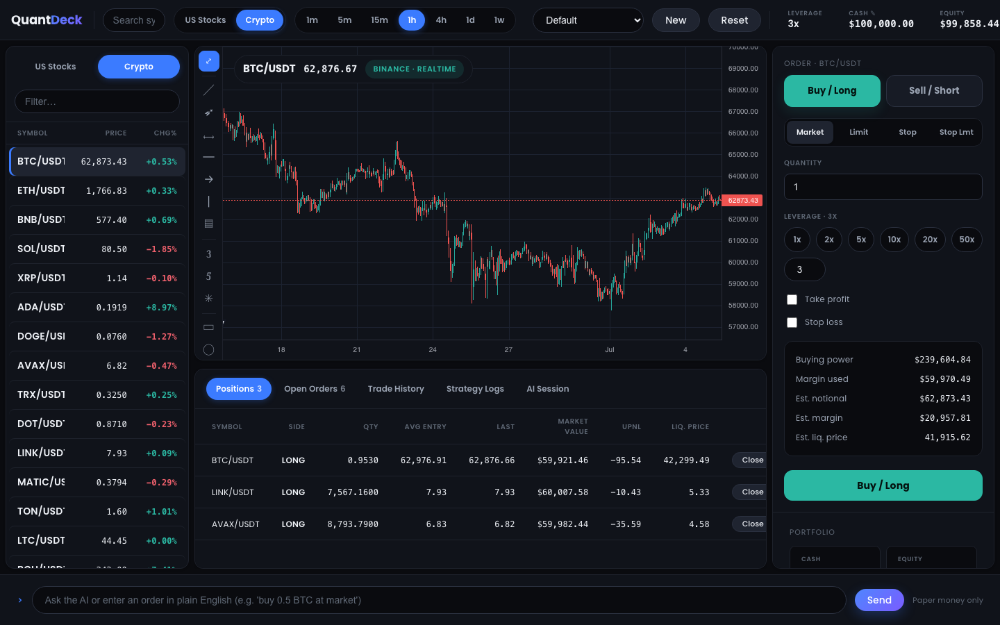

# QuantDeck

QuantDeck is a paper-trading platform for US stocks, styled like TradingView. You get a $100,000 demo account and trade real stocks at real market prices, but no real money is ever involved. There is no broker connection anywhere in the code.




## Why I built it

Most trading platforms either have very limited free features or charge for the useful ones, especially automated trading. I wanted a free place to test my own trading ideas safely. I also wanted to learn agentic AI (AI that takes real actions instead of only chatting) and MCP, and a trading platform is a good way to do that because every action has a clear result and needs strong safety rules.

## What it does

The terminal shows live prices and candlestick charts for 15 large US companies, such as Apple, Microsoft, Nvidia and Tesla, with 1-minute, 5-minute, 1-hour and 4-hour candles. It tracks your positions, cash, profit and loss, leverage and margin like a real broker would, and prices update on screen without refreshing the page.

You can trade on the same account in four ways:

- **By hand.** Pick a stock, enter a quantity and press Buy or Sell. The terminal keeps this simple with market orders only.
- **With the built-in AI agent.** Give Claude a strategy in plain English, for example "buy the tech stock with the strongest momentum". It then trades on its own, checking the market every 30 seconds. You set limits before it starts: which stocks it may trade, the largest order it can place, how many orders per minute, and the most it may lose in a day. A stop button halts it and closes all its positions.
- **From the Claude app, through MCP.** MCP lets AI apps connect to outside tools. With QuantDeck's MCP server, you can type "buy 10 Apple shares" in the Claude desktop app and it trades your account without opening the website.
- **With your own code.** Write a trading strategy in Python, press Start, and the platform trades by your code until you press Stop. The default example, Strategy A, buys after three green candles in a row and sells on the first red one.

The AI agent, MCP and code strategies can also use limit and stop orders, with stop-loss and take-profit.

## One set of safety checks

Every order, whether it comes from a button, the AI, MCP or your code, goes through the same checkpoint. It checks that there is enough money, that the order is not too large, that leverage stays within the limit and that the daily loss limit has not been reached. Nothing can skip these checks, not even the AI.

## How the AI agent works

Claude does not control anything directly. The app sends Claude your strategy and a list of 11 tools it may use, such as "get a price", "check the portfolio" and "place an order". Claude replies with the tool it wants to use, the app checks the request against your limits, runs it, and sends back the result. This repeats until Claude is done. MCP uses the same 11 tools, but there the Claude app runs the conversation instead of QuantDeck.

## Where the prices and charts come from

Prices come from Alpaca or Finnhub, which are real-time, when their keys are set. If neither is available, the app falls back to Yahoo Finance, which is about 15 minutes delayed. Recent prices are cached for 2 seconds so the app doesn't hit the providers' rate limits, and if every provider fails it shows the last known price instead of inventing one.

The providers send plain numbers for each candle (open, high, low, close), not pictures. TradingView's open-source charting library draws the candles in the browser, and QuantDeck builds the current, still-forming candle itself from the live price updates.

## Why strategies run in a sandbox

Strategy code is written by the user, so the platform can't trust it. Code could try to delete files, read secret keys or run forever and freeze the server. So every strategy is checked before it runs, and anything dangerous, like file or network access, is rejected. It then runs as a separate program with limits on CPU time and memory. It can only send requests like "buy 10 AAPL", which go through the same safety checks as every other order. If it crashes, only that strategy stops.

## Tech stack

- **Backend:** Python, FastAPI, SQLite, WebSockets
- **Frontend:** React, TypeScript, Vite, lightweight-charts
- **AI:** Claude through the Anthropic API, and an MCP server
- **Deployment:** Docker, hosted on Render

## Run it locally

```bash
./start.sh
```

Then open `http://localhost:5173`. Optional keys go in `backend/.env` (see `backend/.env.example`): Alpaca or Finnhub keys for real-time prices, and `ANTHROPIC_API_KEY` for the AI agent. On the public demo the AI is turned off, because there is no login yet and anyone could use up the API credits.
