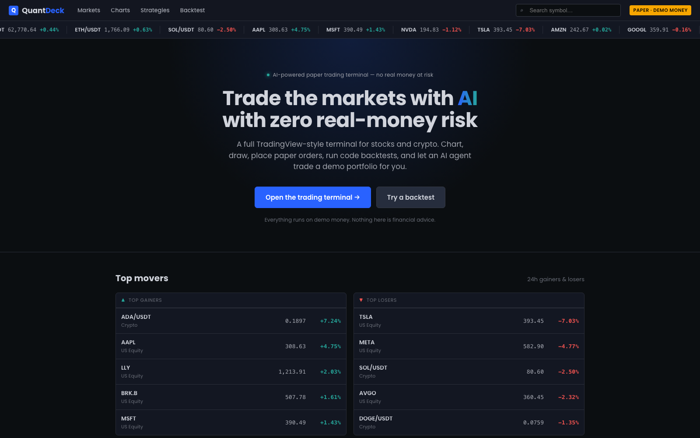
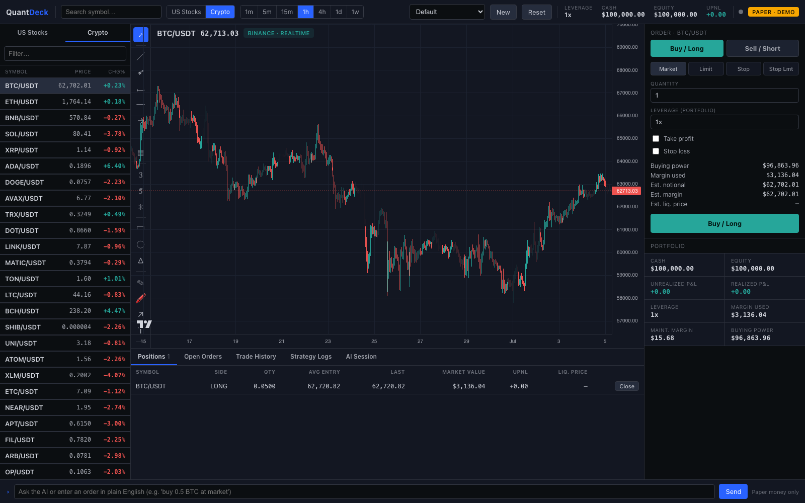

# QuantDeck

A paper-trading terminal for testing trading ideas — by hand, by AI, or by
code — against live US-equity markets, with none of it touching real money.




There is no brokerage or exchange integration anywhere in the codebase, and
no config flag that adds one. The only external credentials it ever uses are
read-only market-data keys and an optional Anthropic key for the AI features.
Every balance, fill, and P&L number is simulated.

## 1. What it does

You can watch the full S&P 500 on a candlestick chart with a real
drawing-tool set (trend lines, Fibonacci, channels, long/short markers), then
act on what you see three ways: place an order by hand,
type a plain-English instruction ("buy 10 AAPL") for an AI to translate into
an order, or write a Python strategy that trades on its own on live paper
money. Positions carry leverage, margin, and liquidation
math, not just a flat cash balance.

## 2. One engine, one risk path

Every order — whether it came from the UI, from the AI chat, from an MCP
client, or from a running strategy — goes through the same
`TradingEngine.place_order()` call and the same validation (symbol
allowlist, notional caps, buying power, max leverage, daily-loss breaker).
This isn't a convention teams are expected to follow; the engine is behind a
frozen `Protocol` interface, so nothing downstream can quietly get a
private, less-checked path to the order book.

```
market data ──► TradingEngine ──┬─► REST + WebSocket API ──► React terminal
(Yahoo/Finnhub/     (orders,     ├─► MCP server ──► Claude Desktop / Code
    Alpaca)         fills,       └─► strategy sandbox
                    positions,
                    margin)
```

Backend is Python 3.12 on FastAPI (fully async), SQLAlchemy over SQLite
(swaps to Postgres by changing the connection string, no code changes), plus
`httpx`, `websockets`, `yfinance`, `anthropic`, and `mcp`. Frontend is React
18 + TypeScript + Vite, charted with `lightweight-charts`, state in
`zustand`. Module map, REST/WS contract, and strategy authoring docs live in
`docs/` (`SPINE.md`, `API_CONTRACT.md`, `FRONTEND_SPEC.md`, `STRATEGIES.md`,
`MCP.md`).

## 3. Market data: routed through a provider chain, never invented

US equities try Finnhub or Alpaca first if you've set keys for them, and
fall back to Yahoo (15-minute delayed) if not. Every quote carries its own
`source` and `delay` label rather than presenting everything as equally
fresh.

If every provider fails, the service serves the last cached price rather
than fabricate one — and if there's no cache either, it returns an honest
error instead of a zero or a stale-looking success.

## 4. The strategy sandbox, and why NumPy and pandas are banned

A user strategy is untrusted code by default, so it's checked twice before it
can trade. First, a static AST pass rejects dangerous imports (`os`,
`subprocess`, `socket`, `pickle`, ...) and any attempt to reach for dunder
attributes like `__globals__` or `__subclasses__` — the standard levers for
escaping a Python sandbox. Second, live strategies additionally run in a
separate subprocess with OS-level CPU and memory limits, talking to the
parent process only through a JSON line protocol; the child never has a
handle to the real engine, only "I want to buy" style intents that the
parent validates and executes.

NumPy and pandas are both backend dependencies (`yfinance` uses them) but
they are deliberately kept off the strategy import allowlist, even though
importing them would pass the AST scan cleanly. The reason: `pd.read_pickle`
deserializes arbitrary pickles, which is arbitrary code execution via
`__reduce__`, and `pd.read_csv` / `np.load` / `ndarray.tofile` grant
arbitrary host filesystem read and write — none of that touches any of the
constructs the scanner or the restricted builtins are watching for, and the
subprocess sandbox only isolates CPU/memory, not the filesystem. Rather than
pretend that's covered, the two libraries stay out entirely until real OS
containment (namespaces, seccomp, a container) is in place.

## 5. AI trading and MCP

With an `ANTHROPIC_API_KEY` set, the terminal's AI panel takes a plain-
English strategy brief plus guardrails — allowed symbols, max order size, max
orders per minute, max daily loss — and trades autonomously, streaming its
reasoning and every tool call live. Those guardrails are checked in the AI
dispatch layer *before* an order is even built, on top of the engine's own
checks — belt and suspenders rather than trusting one gate. `stop()` is
always a kill switch: it halts the session and flattens every open position.

The same 11-tool schema (quotes, OHLCV, portfolio/orders/history,
place/cancel/modify order, market summary) backs both that in-app
AI and a standalone MCP server, so Claude Desktop or Claude Code can trade a
paper account too — over HTTP calls to the same running API, which means an
external MCP client is just as bound by the shared risk path as everything
else. Without a key, none of this errors out; the API returns an honest
"AI disabled" response and the rest of the app works normally.

On the public Render deploy this is left off on purpose: there's no login on
that URL, so a live `ANTHROPIC_API_KEY` would let anyone burn your API
credits. See `docs/DEPLOY.md` for the reasoning and how to turn it on safely
if you add auth.

## 6. Tests

```
$ cd backend && pytest -q
32 passed in 6.66s
```

The suite runs against a deterministic fake market-data provider, so there's
no network I/O and no flakiness. Coverage: position/P&L/margin/liquidation
math in isolation (`test_accounting.py`), order flow through the engine —
limits, shorts, leverage, rejections, bracket TP/SL, flatten-all
(`test_engine.py`), and symbol classification / S&P 500
loading (`test_marketdata_offline.py`). There's no frontend test suite yet —
UI correctness right now rests on manual testing in a real browser, not
automation.

## 7. Running it

```bash
./start.sh
```

First run creates the backend venv, installs Python and npm dependencies,
then starts the API on `:8000` and the frontend on `:5173` together, waiting
for the backend health check before opening the UI. Ctrl+C stops both. Ports
are configurable (`QUANTDECK_PORT=9000 FRONTEND_PORT=5000 ./start.sh`).

For real-time US-equity data, add a free Finnhub or Alpaca key to
`backend/.env`; otherwise it falls back to delayed Yahoo data automatically.
Add `ANTHROPIC_API_KEY` to enable the AI features.

<details>
<summary>Run the two services separately</summary>

```bash
./scripts/run_backend.sh     # API on :8000
./scripts/run_frontend.sh    # UI on :5173, in another terminal
```
</details>

### Deploying

Ships as a single Docker image — the backend serves the built frontend from
one origin, so there's no CORS to configure. Easiest path is Render (push to
GitHub, then Blueprint → this repo, it reads `render.yaml`); the image also
runs anywhere that takes a `$PORT`-bound container (Fly.io, Railway, a VPS).
Full instructions, plan tradeoffs, and the region/AI-key caveats above are in
`docs/DEPLOY.md`.

## 8. Project layout

```
backend/
  quantdeck/
    core/         canonical models, config, event bus, errors, symbols
    db/           async SQLAlchemy models + session
    marketdata/   provider adapters + MarketDataService (+ S&P 500 loader)
    engine/       TradingEngine, accounting, matching, persistence
    strategies/   Strategy SDK, loader, subprocess sandbox, live runner
    ai/           MCP tool schema + dispatch, AI session manager
    api/          FastAPI app, routers, WebSockets
    mcp_server/   standalone MCP stdio server
  strategies_examples/   sma_crossover, rsi_reversion, buy_and_hold
  tests/          pytest suite
frontend/
  src/
    api/          typed REST client + WS helpers + shared types
    pages/        HomePage, TerminalPage, StrategiesPage
    components/   terminal/*, drawing/*, StrategyManager, AISessionPanel
    state/        zustand store
docs/             SPINE, API_CONTRACT, FRONTEND_SPEC, STRATEGIES, MCP, DEPLOY
```
