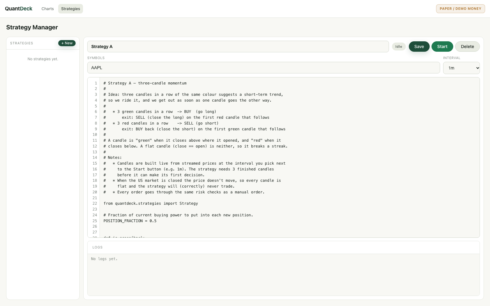

# QuantDeck

A paper-trading platform for US stocks. Trade by hand, with an AI agent, or with your own code, using demo money only.




## Features

- Live prices and candlestick charts for 15 large US stocks (1m, 5m, 1h, 4h)
- Four ways to trade:
  - **Manual:** buy and sell from the terminal
  - **AI agent:** give Claude a strategy in plain English and it trades on its own, within limits you set
  - **MCP:** trade from the Claude desktop app
  - **Code:** write a Python strategy and run it live in a sandbox
- Positions, P&L, leverage and margin tracking
- Every order, from any source, goes through the same risk checks
- No real money and no broker connection

## Tech stack

- **Backend:** Python, FastAPI, SQLite, WebSockets
- **Frontend:** React, TypeScript, Vite, lightweight-charts
- **AI:** Claude (Anthropic API), MCP
- **Deploy:** Docker, Render

## Market data

Prices come from Alpaca or Finnhub (real-time) when keys are set, with Yahoo Finance (15-minute delay) as the fallback.

## Run locally

```bash
./start.sh
```

Then open `http://localhost:5173`.

Optional keys go in `backend/.env` (see `backend/.env.example`):

- `QUANTDECK_ALPACA_API_KEY` and `QUANTDECK_ALPACA_API_SECRET`, or `QUANTDECK_FINNHUB_API_KEY`, for real-time prices
- `ANTHROPIC_API_KEY` for the AI agent
